<h1 align="center">CinemaX · Cinema Booking System</h1>

<picture>
  <source media="(max-width: 820px)" srcset="docs/readme/hero-mobile.svg">
  
</picture>

<p align="center">
  <a href="#the-experience">The experience</a> &nbsp; / &nbsp;
  <a href="#behind-the-screens">Behind the screens</a> &nbsp; / &nbsp;
  <a href="#the-engine">The engine</a> &nbsp; / &nbsp;
  <a href="#local-premiere">Run locally</a>
</p>

<a id="the-experience"></a>

<picture>
  <source media="(max-width: 820px)" srcset="docs/readme/experience-mobile.svg">
  
</picture>

<a id="behind-the-screens"></a>

<picture>
  <source media="(max-width: 820px)" srcset="docs/readme/operations-mobile.svg">
  
</picture>

<a id="the-engine"></a>

<picture>
  <source media="(max-width: 820px)" srcset="docs/readme/architecture-mobile.svg">
  
</picture>

<a id="local-premiere"></a>

<picture>
  <source media="(max-width: 820px)" srcset="docs/readme/launch-mobile.svg">
  
</picture>

<details>
<summary><strong>01 &nbsp; Install &amp; configure</strong></summary>

Enable PHP's PDO driver for your database (`pdo_sqlite` or `pdo_mysql`). From the project directory, using a fresh local database:

```sh
composer install
npm install
php -r "file_exists('.env') || copy('.env.example', '.env');"
php artisan key:generate
```

Set `APP_URL=http://localhost:8000`. Configure `DB_*` for SQLite or an empty MySQL database. For SQLite, create the database file if needed:

```sh
php -r "file_exists('database/database.sqlite') || touch('database/database.sqlite');"
php artisan migrate
php artisan storage:link
```

For local use, set `CACHE_STORE=file` and `QUEUE_CONNECTION=sync`; cache/jobs table migrations are absent. `SESSION_DRIVER=database` is supported by the included sessions migration. Read **Current repository notes** before the first run.

Open separate terminals:

```sh
php artisan serve
npm run dev
php artisan schedule:work
```

The scheduler removes expired pending bookings every minute. For a production asset build, use `npm run build` after resolving the Vite entries below. On Windows PowerShell with script execution restrictions, use `npm.cmd`.

</details>

<details>
<summary><strong>02 &nbsp; Integrations &amp; entry points</strong></summary>

| Connection | Configuration |
| :--- | :--- |
| Email verification | Set `MAIL_*` for SMTP; `MAIL_MAILER=log` writes codes to `storage/logs/laravel.log`. |
| Google sign-in | `GOOGLE_CLIENT_ID`, `GOOGLE_CLIENT_SECRET`, `GOOGLE_REDIRECT_URI=http://localhost:8000/auth/google/callback` |
| Stripe card checkout | `STRIPE_PUBLISHABLE_KEY`, `STRIPE_SECRET_KEY`, `STRIPE_WEBHOOK_SECRET`; current currency: **USD**. Webhook: `POST /booking/stripe/webhook`. |

Google and Stripe controllers reference `laravel/socialite` and `stripe/stripe-php`, which are **missing from the committed Composer manifest and lockfile**. To enable those flows in your local copy:

```sh
composer require laravel/socialite stripe/stripe-php
```

| Portal | Local path |
| :--- | :--- |
| Customer | `/users/homepage` · `/users/login` · `/users/sign-up` |
| Supervisor | `/admin/login` |
| Branch manager | `/manager/login` |
| Employee login scaffold | `/employees/login` |

Create a local supervisor with `php artisan db:seed --class=SupervisorSeeder`; its development credentials are in [the seeder](database/seeders/SupervisorSeeder.php). The default `DatabaseSeeder` only creates a manager, without a cinema assignment. Use the admin portal to create cities, cinemas, theatre/seat templates and halls; assign a manager, add a film with pricing and quotas, then submit and approve showtimes to populate the customer catalogue.

</details>

<details>
<summary><strong>03 &nbsp; Current repository notes</strong></summary>

- **Assets:** `vite.config.js` references missing `resources/css/movie_proposals.css` and `resources/js/movie_proposals.js`; `npm run build` currently fails. Several Blade `@vite` entries are also absent from the build inputs. Reconcile those paths before a production build.
- **Fresh database:** the final `2026_06_05_102500` migration drops foreign-key columns before their constraints; a clean SQLite migration currently fails there. Resolve the constraint removal before completing first-time setup. MySQL migration compatibility has not been verified.
- **Scope:** customer F&B add-ons are a placeholder; admin F&B catalogue management exists. Employee login currently returns plain status text; the seat-monitor middleware currently accepts supervisors and managers.
- **Checks:** `php artisan test` runs the included starter tests; the booking and payment workflows have no dedicated test coverage yet.

</details>

<p align="center"><a href="routes/web.php">Routes</a> &nbsp; · &nbsp; <a href="app/Models">Data model</a> &nbsp; · &nbsp; <a href="resources/views">Interfaces</a> &nbsp; · &nbsp; <a href="docs/readme/generate.py">Artwork source</a></p>

<picture>
  <source media="(max-width: 820px)" srcset="docs/readme/footer-mobile.svg">
  
</picture>
